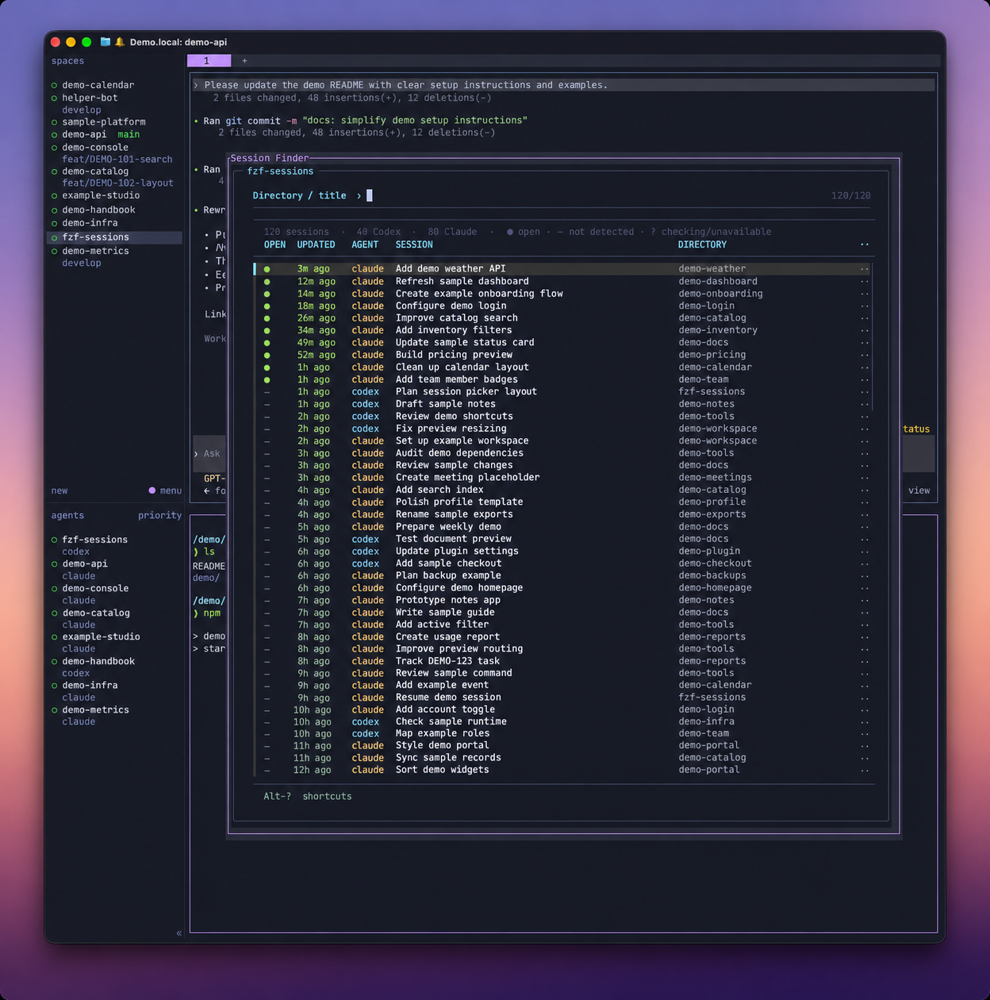

# fzf-sessions

Find your Codex and Claude Code sessions and pick up where you left off.



- Search sessions across all your projects.
- Search by folder and title, or search the conversation itself.
- Read a preview before resuming.
- In Herdr, jump to sessions that are already open—even in another workspace.
- Runs locally. No API keys, cloud summaries, or Python packages to install.

## Install

You need:

- **macOS or Linux.** WSL works too; native Windows is not supported.
- **Python 3.10+** and **[fzf 0.74.5+](https://github.com/junegunn/fzf)**.
- **Codex or Claude Code** to resume that tool's sessions.
- **Herdr 0.9.5+** if you want to use the Herdr plugin.

On macOS, install fzf with `brew install fzf`. On Linux, check your package's
version or download fzf from [its releases](https://github.com/junegunn/fzf/releases).

Clone this repo, then install:

```sh
git clone https://github.com/christianblessing-me/fzf-sessions.git
cd fzf-sessions
python3 install.py
```

- Add `export PATH="$HOME/.local/bin:$PATH"` to your shell config.
- The tool is installed in `~/.local/share/fzf-sessions`.
- To check your setup, run `fzf-sessions --doctor`.
- To try it without installing, run `./fzf-sessions` from the repo folder.

## Use it

```sh
fzf-sessions                 # Browse all sessions
fzf-sessions my-project      # Start with a search
fzf-sessions --here          # Only this exact folder
fzf-sessions --tool claude   # Only Claude Code sessions
fzf-sessions --dry-run       # Print the resume command instead of running it
```

- Type to search folder names and session titles. Full titles are searchable,
  even when shortened in the list.
- Press **Alt-S** to search conversations instead. Each word must appear in the
  saved messages; matching ignores case.
- Press **Enter** to resume in the session's original folder.
- Press **Alt-P** to open the preview. It starts hidden.
- Press **Alt-?** to see all shortcuts.

### Shortcuts

- **↑ / ↓** — move through sessions.
- **Enter** — resume, or jump to an open session in Herdr.
- **Esc / Ctrl-C** — close the list.
- **Alt-S** — switch between folder/title and conversation search.
- **Alt-P** — show or hide the preview.
- **Shift-↑ / Shift-↓** — scroll the preview.
- **Alt-C** — copy the resume command and close the list (macOS).
- **Alt-R** — refresh open-session markers (inside Herdr).
- **Alt-?** — open shortcut help. **Esc**, **Enter**, or **Alt-?** closes it.

## Use it in Herdr

Run these commands from a terminal inside Herdr:

```sh
herdr plugin link "$HOME/.local/share/fzf-sessions"
herdr plugin action invoke fzf-sessions.open
```

- The session list opens in a popup over your workspace.
- Open sessions appear first, across all tabs and workspaces on the connected server.
- **Enter** jumps to an existing session. If none is found, it resumes in a new workspace.
- **Alt-R** refreshes which sessions are open.
- The **OPEN** column uses **●** for a detected session, **—** for no match,
  and **?** while checking or when Herdr is unavailable.
- The preview shows where a session is open.

To add a keyboard shortcut, put this in your Herdr config. Choose a key that is free:

```toml
[[keys.command]]
key = "prefix+shift+s"
type = "plugin_action"
command = "fzf-sessions.open"
description = "Find a coding session"
```

## Previews and summaries

- The preview shows saved messages and the latest recorded token usage.
- In conversation search, it also shows matching passages.
- On supported Macs, Apple's local model can add a **Goal / Progress / Next** summary.
- AI summaries need macOS 27+, Apple Intelligence, and Apple's `fm` command.
  Accept its terms with `sudo fm license`, then check availability with `fm models`.
- If the model is unavailable, the preview explains why and shows saved messages.
- Summaries stay on your machine and are saved for reuse. They use excerpts and can be wrong.
- Token counts come from saved sessions. They are not live context measurements
  or subscription limits. No prices are shown.

## Settings

- `CODEX_HOME` — Codex history folder. Default: `~/.codex`.
- `CLAUDE_CONFIG_DIR` — Claude Code history folder. Default: `~/.claude`.
- `FZF_SESSIONS_NO_AI=1` — turn off AI summaries.
- `NO_COLOR=1` — turn off colors.
- `--list` — print session details as JSON without opening the list.
- `--version` — show the installed version.
- `--doctor` — check your setup without reading conversations or starting agents.

## Update or remove

- **Update:** get the latest source, close open session lists, and run `python3 install.py` again.
- **Custom location:** use `python3 install.py --prefix /your/location`.
  Use the same prefix when uninstalling.
- **Remove:** unlink the Herdr plugin first if you linked the installed copy,
  then run the uninstaller below. Your session history and saved summaries are kept.

```sh
herdr plugin unlink fzf-sessions
python3 "$HOME/.local/share/fzf-sessions/install.py" --uninstall
```

## More details

- [How sessions, search, and usage counts work](docs/reference.md)
- [Development and tests](docs/development.md)
- [Release guide](docs/releasing.md)
- [Changelog](CHANGELOG.md)
- [MIT license](LICENSE)
